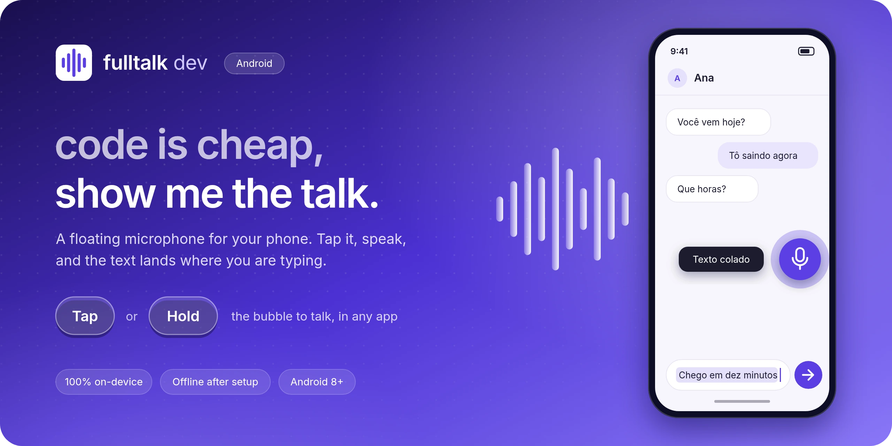
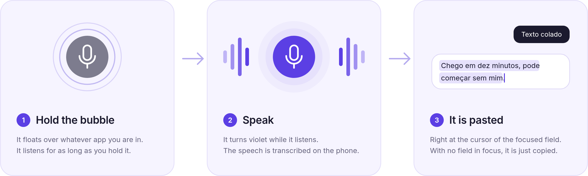
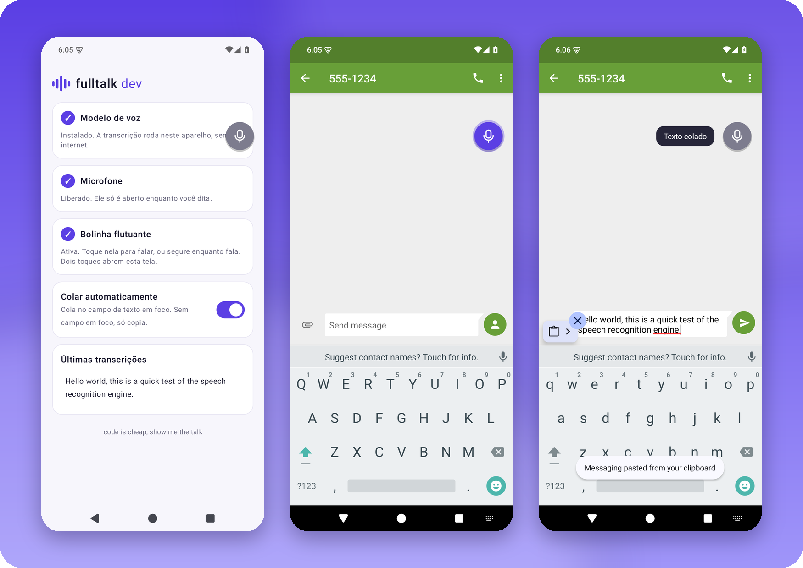
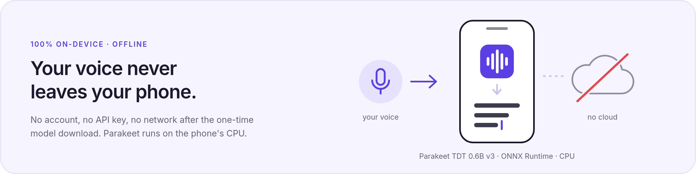

<div align="center">



<br><br>

A floating microphone for your phone. Tap it, speak, and the text lands in whatever
field you are typing in. The speech is transcribed on the device: nothing leaves it.

[](https://github.com/RafaelFariaFerreira/fulltalk-android/actions/workflows/ci.yml)
[](https://github.com/RafaelFariaFerreira/fulltalk-android/releases/latest)


[](LICENSE)

**[Install](#install)** · [How it works](#how-it-works) · [Privacy](#privacy-and-permissions) · [Architecture](#architecture) · [Testing](#testing) · [Status](#status)

</div>

This is the Android companion of [fulltalk dev](https://github.com/RafaelFariaFerreira/fulltalk-dev),
the desktop push-to-talk dictation app. Same idea, same model, same rules, rebuilt for a
touch screen.

## How it works

<picture>
  <source media="(prefers-color-scheme: dark)" srcset="docs/illustrations/how-it-works-dark.png">
  
</picture>

The app is a single bubble that floats over every other app:

| Gesture | What it does |
|---|---|
| **Tap** | Starts recording. Tap again to stop and transcribe. While it transcribes the bubble shows an ✕: tap it to cancel. |
| **Hold** | Records while your finger is down, transcribes when you let go. |
| **Double tap** | Opens the app (setup, settings, recent transcriptions). |
| **Drag** | Moves the bubble. It remembers where you left it. |

The bubble is grey while idle, violet while it listens or transcribes, and amber when
something went wrong. A short note appears beside it to say what happened
("Texto colado", "Nada foi captado").

When the transcription is ready it always goes to the clipboard. If a text field has
focus, it is also pasted there, at the cursor. The last five transcriptions stay in the
app, one tap to copy again.

<div align="center">

</div>

## Privacy and permissions

<picture>
  <source media="(prefers-color-scheme: dark)" srcset="docs/illustrations/local-dark.png">
  
</picture>

| Permission | Why |
|---|---|
| **Microphone** | To hear you. It is only open while the bubble is violet. |
| **Accessibility service** | Two things, and nothing else: it lets the bubble's window sit on top of other apps, and it tells the app which text field has focus so the transcription can be pasted there. The service does not listen to accessibility events and does not read, store or send anything that is on screen. |
| **Internet** | Used once, to download the speech model (670 MB). After that the app works offline. |

Recognition runs on the phone's CPU with [NVIDIA Parakeet TDT 0.6B v3](https://huggingface.co/nvidia/parakeet-tdt-0.6b-v3)
through [sherpa-onnx](https://github.com/k2-fsa/sherpa-onnx). There is no account, no API
key and no server. Dictated text is excluded from cloud backup and device transfer.

## Install

**[Download fulltalk-dev.apk](https://github.com/RafaelFariaFerreira/fulltalk-android/releases/latest/download/fulltalk-dev.apk)**
(40 MB). It needs Android 8.0 or newer on a 64-bit ARM phone, which is any phone from
the last several years. Older versions are on the
[releases page](https://github.com/RafaelFariaFerreira/fulltalk-android/releases).

1. **Open the downloaded file** on the phone. The first time, Android asks whether your
   browser or file manager may install apps (*Instalar apps desconhecidos*): allow it,
   go back and tap **Install**.
2. **Open fulltalk dev** and follow its three steps:
   - **Modelo de voz**: download the speech model. It is 670 MB, so use Wi-Fi. An
     interrupted download resumes, and every file is verified against its size and
     SHA-256 before it is used.
   - **Microfone**: allow the microphone.
   - **Bolinha flutuante**: turn fulltalk dev on under Settings → Accessibility. Android
     asks whether the app may have "full control of your device", which is its wording
     for every accessibility service. What this one does with it is in
     [the table above](#privacy-and-permissions).
3. The bubble appears in the top-right corner. Put the cursor in any text field and tap it.

### If Android gets in the way

fulltalk dev comes from outside the Play Store and asks for an accessibility service.
Banking trojans look the same from the outside, so Android may refuse at up to three
points. None of them is about this app in particular, and each one can be switched off
for the minute it takes.

| What you see | Why | What to do |
|---|---|---|
| Play Protect blocks the install outright, with no button to continue | Its fraud protection, active in Brazil and a growing list of countries, refuses any APK that arrives through a browser, a messaging app or a file manager and declares an accessibility service. | Play Store → your picture → **Play Protect** → ⚙ → turn off **Scan apps with Play Protect** (*Verificar apps com o Play Protect*). Install the APK, then turn it back on. Or [install over USB](#install-over-usb), which this check does not cover. |
| Play Protect says it does not know the app or its developer | The ordinary warning for an app Google has not seen before. | **Scan app**, then **Install**. If it only warns: **More details → Install anyway**. |
| On a Samsung, a message that Auto Blocker stopped the install | Auto Blocker (*Bloqueador automático*) only lets the Play Store and the Galaxy Store install apps. It also blocks commands sent over USB. | Settings → Security and privacy → **Auto Blocker** → off. Install, then turn it back on. |
| "Restricted setting" when you turn the service on under Accessibility, or the switch is greyed out | Since Android 13, an app installed from a file cannot become an accessibility service until you say so. | Settings → Apps → fulltalk dev → **⋮** (top right) → **Allow restricted settings** (*Permitir configurações restritas*), confirm with your PIN or fingerprint, then go back to Accessibility. The menu entry only exists after you have seen the "Restricted setting" message once. |
| The bubble is gone after a few hours | Some phones (Xiaomi, Samsung, Oppo and others) stop background services to save battery. | Settings → Apps → fulltalk dev → Battery → **Unrestricted**, then turn the service on again under Accessibility. |

**Developer verification.** Since 30 September 2026, Android checks in Brazil, Indonesia,
Singapore and Thailand that an app's developer is registered with Google. For now that
covers apps coming from the participating app stores, not a file you downloaded
yourself, so it does not affect this APK. Google plans to widen it in 2027. If your
phone then refuses the install because the developer is unverified, either install over
USB, which is exempt, or turn on **Apps from unverified developers** under Developer
options: the phone restarts, makes you wait 24 hours once, and then lets you confirm.

### Install over USB

The route with the fewest obstacles. Play Protect's fraud block and developer
verification do not apply to it, and neither does the "Restricted setting" step
(checked on Android 15).

1. On the phone: Settings → About phone → tap **Build number** seven times. Then
   Settings → System → Developer options → turn on **USB debugging**. On a Xiaomi, also
   turn on **Install via USB**. On a Samsung, turn Auto Blocker off first.
2. On the computer: get `adb` from the
   [Android platform tools](https://developer.android.com/tools/releases/platform-tools),
   plug the phone in and accept the "Allow USB debugging?" prompt on its screen.
3. Install:

   ```sh
   adb install fulltalk-dev.apk
   ```

Then follow steps 2 and 3 above. USB debugging can be turned off again afterwards.

### Check what you downloaded

Each release lists the SHA-256 of its APK. All of them are signed with the same key:

```sh
sha256sum fulltalk-dev.apk
apksigner verify --print-certs fulltalk-dev.apk
# Signer #1 certificate SHA-256 digest: 254bef839025e1e3f2480d3810ef6da70a15c7117ca529cc044a80e2c4a589f0
```

### Build from source

Requirements: JDK 17 or newer and the Android SDK (platform 37, build tools). Android
Studio brings both; from a terminal, set `ANDROID_HOME` to the SDK.

```sh
git clone https://github.com/RafaelFariaFerreira/fulltalk-android.git
cd fulltalk-android
./gradlew :app:assembleDebug
adb install app/build/outputs/apk/debug/app-debug.apk
```

The first build downloads sherpa-onnx (49 MB) and checks it against a pinned SHA-256.
A debug build and a release are signed with different keys, so one cannot be installed
over the other: uninstall first.

## Architecture

```
core/   pure Kotlin, no Android: the rules. Runs and is tested on a plain JVM.
app/    Android: the bubble, the microphone, the model, the screen.
```

| Module | Responsibility | Tests |
|---|---|---|
| [`core`](core) | Session state machine, bubble gesture recognition, history, text clean-up, silence gate, paste-or-clipboard policy, verified model installer | 60 unit tests |
| [`app`](app) | Accessibility service with the floating bubble, `AudioRecord` capture, sherpa-onnx transcriber, model download, Compose screen | exercised on an emulator (see below) |

Some decisions worth calling out:

- **The flow is a pure state machine.** [`Session`](core/src/main/kotlin/dev/fulltalk/core/Session.kt)
  takes inputs (`Tapped`, `HoldStarted`, …) and answers with effects (`StartCapture`,
  `Deliver`, …). Every rule, such as "letting go does not stop a recording that a tap
  started", is a unit test with no microphone, model or screen involved. It is a port of
  the desktop app's Rust state machine.
- **One finger, four meanings.** [`BubbleGesture`](core/src/main/kotlin/dev/fulltalk/core/BubbleGesture.kt)
  tells tap, double tap, hold and drag apart. The first tap of a double tap acts at once,
  so a single tap never waits for a timeout; the second one cancels the recording the
  first one started instead of transcribing a fraction of a second.
- **An accessibility overlay, not "draw over other apps".** The bubble's window is of
  type `TYPE_ACCESSIBILITY_OVERLAY`, which the accessibility service is allowed to add by
  itself. That saves a second scary permission, and the window is never focusable, so
  the field you are typing in keeps the focus and the keyboard.
- **No toasts.** Android drops toasts from apps that are in the background without the
  notification permission, and the bubble always is. Messages are drawn in a small
  window of their own beside the bubble.
- **Pinned downloads.** The model comes from a pinned Hugging Face revision and
  sherpa-onnx from a pinned release; both are checked against SHA-256 sums that live in
  the source.

## Testing

```sh
./gradlew :core:test            # 60 unit tests, plain JVM
./gradlew :app:lintDebug        # Android lint, warnings are errors
scripts/make-illustrations.py   # render docs/illustrations/*.svg (needs Chrome and Pillow)
scripts/make-hero.py            # compose docs/hero.png from the screenshots (needs Pillow)
```

Emulators rarely have a usable microphone, so debug builds accept a recording in its
place. Everything else stays real: the touches, the state machine, the model and the
paste.

```sh
adb push speech.wav /data/local/tmp/                        # 16 kHz, mono, 16-bit PCM
adb shell run-as dev.fulltalk.app cp /data/local/tmp/speech.wav files/
adb shell am broadcast -a dev.fulltalk.app.debug.DICTATE \
    --es path /data/user/0/dev.fulltalk.app/files/speech.wav
# the next recording made with the bubble uses that file
```

Avoid `uiautomator dump` while testing: it suspends every accessibility service, the
bubble included.

## Releasing

Release APKs are signed with a key that is not in the repository. Point the Gradle
property `fulltalk.keystore` (in `~/.gradle/gradle.properties`) or the
`FULLTALK_KEYSTORE` environment variable at a properties file with `storeFile`,
`storePassword`, `keyAlias` and `keyPassword`. Then, on a clean and pushed `main`:

```sh
scripts/release.sh        # builds the arm64 APK and publishes v<versionName> on GitHub
```

## Status

✅ verified on an emulator (Android 15, x86_64) · 🧪 implemented, not yet verified

| | |
|---|---|
| Model download with resume and verification | ✅ |
| Bubble over other apps, never taking focus | ✅ |
| Tap, hold, double tap and drag | ✅ |
| Microphone opened from the bubble while another app is in front | ✅ (the system allows it; the emulator itself hears only silence) |
| Transcription and paste into the focused field | ✅ with an injected recording |
| Speed and memory on a real phone | 🧪 |
| Real speech through a real microphone | 🧪 |

On the emulator, which runs the model on a software-emulated CPU, loading takes about
half a minute and 4 s of speech take about 7 s to transcribe. Those numbers say little
about a phone; measuring one is the next step.

Known limits: the model needs a phone with plenty of memory (it uses about 800 MB on
the desktop), and two dictations in a row are pasted without a space between them.

## Credits

- [NVIDIA Parakeet TDT 0.6B v3](https://huggingface.co/nvidia/parakeet-tdt-0.6b-v3) (CC BY 4.0), in the int8 ONNX export packaged by [csukuangfj](https://huggingface.co/csukuangfj/sherpa-onnx-nemo-parakeet-tdt-0.6b-v3-int8)
- [sherpa-onnx](https://github.com/k2-fsa/sherpa-onnx) and [ONNX Runtime](https://onnxruntime.ai)
- [Jetpack Compose](https://developer.android.com/compose)
- [Inter](https://rsms.me/inter/) (OFL), used in the illustrations

## License

[MIT](LICENSE) © Rafael Faria Ferreira
